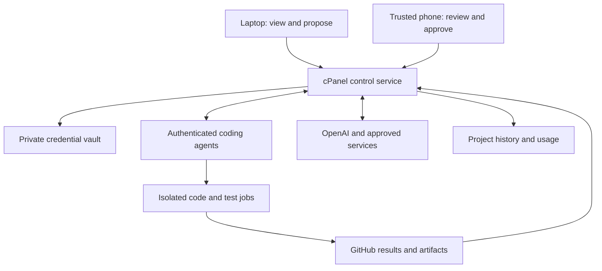

# AIcontrol — coding team handover

**Date:** 9 November 2026  
**Repository:** https://github.com/efrgdgr0024345/AIcontrol  
**Status:** Build specification and implementation handover. This document does not certify the current prototype as production-ready.

## 1. The objective

Build a private, useful control panel for managing coding projects, AI agents, connected systems, credentials, approvals, deployments and usage history. Keep the owner's established `loader.php` installation and update method.

The central security requirement is:

> All long-lived service keys, service passwords and operational private keys are held by cPanel. Generate our own secrets on the server. Let cPanel and authenticated coding agents communicate directly. The laptop is a screen and a source of proposed work; it must not carry, generate, store or relay those credentials.

The owner must be able to answer: What is being worked on? Who is doing it? What systems can they use? What permission was granted? What actually happened? What did it cost? What changed? Can I stop or reverse it?

Preserve the previous approach of server-held secrets, private storage, explicit control, exact-commit updates and recoverability. Do not reproduce older workflows that generated pairing secrets on the laptop or relied on copying a privileged token through chat.

## 2. Security outcome and assumptions

Assume an attacker can read the laptop's screen, browser storage, clipboard and local files, steal its browser session, and change requests sent by that browser. Treat agent-produced code, repository text, model output and build artifacts as untrusted input.

The build must prevent a laptop-only compromise from exposing long-lived service secrets, creating a new privileged agent, approving deployments, increasing spend limits, changing credential destinations or enrolling a replacement owner device.

This requires two separate controls:

1. **Secret isolation:** cPanel uses credentials on behalf of callers; browsers and agents do not receive the underlying values.
2. **Authority isolation:** the laptop's session cannot approve its own sensitive requests. Use a separately enrolled trusted phone or other trusted device for those approvals. Display and approve the exact server-stored action on that device.

A password and TOTP entered into the same compromised laptop do not establish that second boundary. A VPN and HTTPS do not repair a compromised browser either. These measures remain useful, but the release must not claim the laptop problem is solved merely because the vault is encrypted.

This architecture does not make the laptop trustworthy: anything displayed there can be captured, and its low-privilege session can be abused within its permitted limits. Nor does it survive unrestricted compromise of the cPanel account that holds both the application and its runtime keys. Reduce that exposure with account isolation, limited connectors, independent audit checkpoints and protected backups.

**Important account boundary:** do not keep cPanel administrator, GitHub owner, provider administrator or recovery sessions on the weak laptop. Those accounts can bypass the application's protections. Use trusted devices for their administration; use a separate restricted identity where laptop access is necessary.

## 3. Components and responsibilities

| Component | Responsibility | Credentials and authority |
|---|---|---|
| Laptop dashboard | View permitted status, create task proposals, inspect redacted results | Short-lived viewer/requester session only; no service secrets or owner approval authority |
| Trusted owner interface | Enroll devices, manage systems, approve exact sensitive actions, revoke access | Independent owner authentication; service values never returned after import |
| cPanel control service | Project state, access policy, job coordination, credential broker, history, updates | Holds encrypted service credentials and server-generated operational keys |
| GitHub | Source, branches, pull requests, reviews, tests and evidence | Narrow repository permissions; no cPanel vault/master key |
| Coding workers | Plan changes, produce patches, run bounded jobs, report progress | Verified workload identity and scoped job permissions; no long-lived provider secrets |
| Disposable test runners | Execute generated code and tests | No production secrets, cPanel filesystem, owner identity or privileged publishing token |
| External AI/provider APIs | Perform approved provider operations | cPanel supplies authentication directly over TLS |

The arrows represent authenticated server interactions or restricted UI calls. They do not mean an agent can download the vault.

## 4. Credential lifecycle: cPanel is the custodian

### 4.1 What is stored where

| Material | Required handling |
|---|---|
| OpenAI and other provider API keys | Encrypted in private cPanel storage; decrypted only inside the relevant adapter during use |
| Service passwords needed for outbound authentication | Encrypted, because the service may need their original value |
| AIcontrol administrator passwords, if supported | Salted password hashes; never reversible plaintext storage |
| Internal API tokens and webhook secrets | Generate with the server CSPRNG; hash if only verifying, encrypt if they must be retrieved for outbound use |
| SSH or signing private keys | Generate on cPanel when needed, keep private; register only the public key with the destination |
| Setup/recovery challenges | Generate on the server, short expiry, single use; store only a verifier where practical |
| Release hashes and credential references | Safe metadata; may appear in history. A hash is not a replacement for authentication |
| Owner passkey | The authenticator's private key stays on the trusted phone/security device; cPanel stores its public verification key. This is distinct from server-held service keys |

Provider-issued credentials cannot be invented locally. Where the provider supports an authorized server-side provisioning or OAuth flow, let cPanel complete it directly. Otherwise, the owner imports the provider key through the trusted phone into cPanel once. Do not use the laptop clipboard, a chat message, a GitHub issue or a workflow input as the transfer channel.

That one-time import necessarily places the owner-entered value in the trusted phone's input and HTTPS request. It is an explicit provisioning exception: never return it in a response, save it in browser storage, reflect it after validation errors or log it. The laptop has no such exception.

### 4.2 Storage rules

- Use a site-specific directory outside **every document root serving this account**, with private directories `0700` and sensitive files `0600`.
- Keep the encryption master key separate from ciphertext files and derive separate keys for encryption, metadata fingerprints and audit integrity.
- Use a maintained authenticated-encryption primitive, such as PHP sodium XChaCha20-Poly1305. Authenticate credential ID, provider, version and intended context.
- Fail closed on missing master keys, unsafe permissions, symlinks, invalid ciphertext or inconsistent audit state. Never silently create a new key over an existing vault.
- Exclude credentials, sessions, runtime data and backups from Git and release archives.
- No browser secret reveal/export endpoint, no raw-key agent endpoint, and no master key in PHP source, JavaScript or public configuration.
- The admin panel displays label, provider, credential reference, version, fingerprint, status, created/rotated dates and last use. Masked characters are presentation only, not a security control.
- Rotation is versioned: install replacement, validate it safely, switch consumers, revoke the previous provider credential, record each result. Do not claim provider revocation succeeded until verified.

All long-lived application service secrets stay on cPanel by default. If an external service technically requires its own short-lived authentication token in a worker, document that exception explicitly, restrict its audience/lifetime/permissions, deliver it directly server-to-server, and exclude it from logs and prompts. Prefer the broker so this exception is unnecessary.

## 5. Remove the laptop from the privileged path

### 5.1 Separate roles, origins and sessions

Implement `viewer`, `requester`, `approver`, `administrator` and `agent` as server-enforced roles. An agent is a machine identity, not an owner session. Use a separate approval origin and host-only cookies where practical; no broad domain cookies shared with ordinary hosted applications.

The laptop can create proposals and view allowed output. A proposal never grants authority. The owner interface on the trusted phone can inspect the canonical request and authorize it. Do not allow a laptop session to become an approver by entering a six-digit code, changing its user agent or claiming to be mobile.

Use a maintained WebAuthn implementation for owner authentication. Enroll the trusted authenticator through a server-authorized setup process. Do not roll custom signature verification or treat ordinary phone-assisted login into the laptop as independent transaction approval. Avoid syncing the approval credential onto the weak laptop. If a provider/authenticator cannot enforce device restriction, document that limit and require approval in the trusted phone's independently established session.

Account recovery, enrolling another approver, modifying the approval origin, lowering policy and changing recovery methods require existing trusted authorization or a documented server-operator recovery procedure. A lost phone must never trigger a convenient laptop-only bypass.

### 5.2 Approve the exact operation

Create an immutable server-side request containing:

`request_id`, project/task IDs, actor/agent identity, operation, target system and repository IDs, source commit, workflow identity, destination, exact arguments or their immutable payload reference, credential reference/version, model, token/cost/runtime limits, policy revision, expiry and allowed use count.

Canonicalize and hash that complete record. Show meaningful fields and the relevant diff/input on the trusted device. A WebAuthn challenge must be associated server-side with that request ID, digest, approver, nonce and expiry. Verify the response against that stored association and the expected origin/RP ID. A generic successful login is not an approval for arbitrary later work.

Immediately before execution, atomically verify identity, digest, expiry, revocation, remaining uses, current policy and budget. Consume the grant before the external effect. Any relevant change creates a new request and requires new authorization. Approval of commit A must not authorize branch `main` after it has moved to commit B.

The UI should support bounded job approvals, so the owner does not need to authorize every harmless read. A job can receive a fixed repository, operation set, time window, maximum call count and budget. Creating production credentials, changing trust policy, merging protected changes and production deployment remain separate sensitive operations.

## 6. Direct cPanel-to-agent communication

### 6.1 A capability broker, not a key vending machine

Provide operations such as `project.read`, `task.claim`, `task.progress`, `repository.read`, `model.respond`, `tests.start`, `artifact.register`, `branch.propose` and `deployment.request`. Each has a typed input schema, explicit permissions, fixed destination policy and bounded result schema.

An agent requests, for example: “Use the configured OpenAI system for task T with this approved input and limit.” cPanel looks up the credential, makes the provider call, records usage and returns the allowed result. The agent does not request “give me the OpenAI key.”

An operation registry maps each capability to its implementation. Reject arbitrary URLs, shell commands, provider authorization headers, credential IDs outside the agent's project, and unexpected input fields. Treat model text as data; it cannot alter policy or enable a new connector.

### 6.2 Workload identity

For GitHub-hosted jobs, use GitHub OIDC to authenticate directly to cPanel. Validate signatures against GitHub's fixed trusted discovery/JWKS endpoints; do not follow token-supplied key URLs. Validate issuer, expected audience, immutable repository/owner IDs, allowed workflow/ref or pinned reusable workflow, event, commit, run ID/attempt and time bounds.

GitHub OIDC proves workload identity. AIcontrol still has to decide authorization. Do not accept every token merely because GitHub signed it, and do not rely on repository names alone.

For other coding-team runtimes, implement a real authenticated adapter using supported OAuth/workload identity or tightly scoped machine credentials issued server-to-server. No shared “all agents” password. Do not pretend a general chat session can call our API until its connector and identity are actually configured.

### 6.3 Execution and publishing separation

Keep the trusted broker adapter separate from the job that runs generated code. Untrusted build steps receive no production secrets, owner tokens, cPanel filesystem access or privileged OIDC capability. Use disposable runners and minimal job permissions.

Use a clean publisher to validate a patch/artifact and write an allowed branch or PR. Do not execute a generated repository hook, package script or build step in the publisher's credentialed process. Changes to workflows, the loader, authentication, authorization and policy need specific review.

Never execute arbitrary project PHP under the cPanel account that holds the vault. A second directory or subdomain under the same Unix account is not sufficient process isolation.

Existing websites running as that same Unix user also share this trust boundary. Phase 0 must inventory them: preferably place AIcontrol under a separate hosting account/user; otherwise explicitly record that a vulnerability in any of those applications could expose the vault. Private file permissions do not isolate applications sharing the same user.

## 7. The control panel: a working project record

### 7.1 Overview and project workspaces

The overview shows active projects, current jobs, recent completed work, outstanding approvals, blockers, failed checks, last agent contact and usage against limits. Every status links to the underlying task, job or evidence. Do not display a fictional “working” animation after an agent stops reporting.

Each project has its brief, owner, scope/version, repository, allowed systems, milestones, tasks, decisions, budget, environment and deployment target. Keep archived projects searchable. Each task has acceptance criteria, dependencies, assigned agent/team, current attempt, progress, evidence and final review outcome.

Use explicit states: `draft`, `queued`, `assigned`, `working`, `waiting_for_approval`, `blocked`, `testing`, `in_review`, `completed`, `failed`, `cancelled`. Status changes record who changed them and why. A successful model response is not a completed coding task; completion requires the task's specified evidence and review.

The project timeline should include briefs and approved scope changes; assignments; concise plans and decisions; agent progress reports; permission requests/decisions; provider operations; commits and PRs; test summaries; deployment attempts; rollback/recovery; errors and resolutions. Store useful decision summaries and observable evidence, not supposed access to a model's private internal reasoning.

### 7.2 Systems catalog

Give the owner one screen listing systems that are supported, configured and usable. Distinguish these states: **supported but not connected**, **configured but unverified**, **healthy**, **restricted**, **expired**, **disabled**, **unavailable**. Never show a green health status merely because a credential was saved.

Initial adapters:

| System | First supported use | Catalog details |
|---|---|---|
| OpenAI | Bounded API requests; later coding-agent orchestration through a verified supported API | Account/project reference, available configured models, permitted operations, limits, last verified call |
| GitHub | Repository metadata, branches/PRs through scoped publishing, checks, workflow runs | Repository IDs, installation/account reference, granted permissions, protected branches |
| GitHub Actions | Isolated build/test jobs and authenticated callbacks | Approved workflow revision, runner class, permissions, concurrency and runtime limits |
| cPanel | AIcontrol hosting, credential use and reviewed deployments | Target identifier/path, PHP compatibility, last installed commit, last successful health check |
| Other agents/MCP/services | Add only after an authenticated adapter exists | Endpoint policy, identity method, operations, owner, data exposure and approval requirements |

Each configured system records a nonsecret ID/name, adapter/version, owner, project allowlist, credential references, approved capabilities, environment, endpoint allowlist, health check time/result, quotas, rotation/expiry, last use and links to usage history. Permit safe connection tests from the trusted owner interface. A potentially billable test must state its bound before it runs.

### 7.3 Agents and permissions

List each real agent identity, its runtime/provider, allowed projects/systems/actions, active jobs, last heartbeat, expiry/revocation state and recent usage. Display verified identity separately from a friendly agent-supplied label. Include controls to pause an agent, revoke its future access and cancel queued work.

Recommended progress contract: workers report state, completed step, next step, blockers and evidence references every 30–60 seconds while active. The server records last contact. After a configurable stale interval, show **contact lost / status unknown**, and reconcile against the actual runner. Heartbeat frequency is a design target, not proof that the worker is healthy.

### 7.4 History and usage

Every broker operation receives a correlation ID connecting project, task, job, attempt, agent, system, credential reference/version, approval and provider request ID. Record requested/approved/started/finished times, operation, bounded outcome/error category, duration, retries, token counts, compute time, artifacts and cost information.

Show both successful and refused uses. A denial, expired grant, failed credential rotation or failed deployment belongs in the history. Distinguish “approved”, “used”, “provider accepted”, “completed” and “outcome uncertain”.

Use append-only events: corrections append a new event referring to the old one. Redact at the point of capture. Never store API keys, passwords, authorization headers, session cookies, JWTs or full credential-bearing request/response dumps. Keep sensitive prompts/code in separate access-controlled records, referenced by ID; do not automatically publish them to GitHub.

Record provider usage as measured, estimated or unavailable. Store billing currency and original amount; display AUD estimates only with the conversion rate/date and estimate label. Missing cost data is **unknown**, not zero. Reconcile against provider invoices or usage APIs when available.

An HMAC-linked local log detects some modification relative to its retained checkpoint. It does not resist an attacker who controls cPanel and can rewrite both log and checkpoint. Add periodic external, append-only checkpoint storage before making stronger audit claims; never publish secrets or sensitive project content with the checkpoint.

“All work” means all work performed through integrated adapters and their required reporting contract. Work done outside those integrations must be imported or clearly marked external/unverified; the panel cannot silently observe every separate chat or provider session.

## 8. Persistence, jobs and API contracts

### 8.1 Production storage

Use cPanel MariaDB/MySQL with transactions for multi-agent operation, after verifying the host's supported configuration. The early prototype's locked JSON files are useful for a single-user demonstration; migrate grants, jobs, budgets and audit events to transactional storage before concurrent production use. Use PDO prepared statements and a dedicated least-privilege database user; keep its password in private server configuration.

Required entities:

| Entity | Essential records |
|---|---|
| Projects / tasks | Scope revision, repository, dependencies, criteria, state and owner |
| Agents / identities | Verified issuer/subject, provider, policy and revocation |
| Systems / credentials | Adapter, capabilities, secret reference/version, metadata and health |
| Jobs / attempts | Assignment, source commit, lease owner, fencing number, heartbeat, result |
| Requests / approvals | Immutable operation digest, approver identity, expiry, limits, state |
| Grants / usage | Bound identity, remaining uses, reservations, actual usage and outcome |
| Events / decisions | Ordered attributable history, correlation IDs, redacted evidence references |
| Artifacts / deployments | SHA-256, source commit, test evidence, destination, backup and rollback |
| Outbox / webhook receipts | Reliable dispatch, deduplication, signature verification and retry state |

Consume permission, reserve budget and append the execution intent in one transaction. Use an outbox to dispatch external work after commit. Process callbacks idempotently. Add unique event/delivery IDs, legal state transitions and row-level locking where appropriate.

Do not claim an external API side effect and a database transaction are globally atomic. If a request times out after the provider may have accepted it, record **outcome uncertain**, query the provider by its request/idempotency key where supported, and reconcile. Do not blindly repeat a billable or destructive request. Retries stay inside the original operation limits or require a new approval.

Use leases with increasing fencing numbers: a timed-out worker must not overwrite a newer attempt. Job cancellation first revokes future broker authority, then requests cancellation from the runner. Show when a remote process may still be running.

### 8.2 API surface

Version the API, enforce authorization in handlers, and validate all fields against schemas. Separate owner, requester and agent routes. Suggested resources: `/projects`, `/tasks`, `/systems`, `/jobs`, `/requests`, `/approvals`, `/operations`, `/events`, `/artifacts`, `/deployments` and `/webhooks/github`.

The browser creates proposals; an agent claims an authorized job; the broker performs a named operation; the provider/worker reports evidence. No endpoint accepts a raw “run anything” command or returns a stored service key. Credentials are referenced by server-controlled IDs, and callers cannot substitute another project's credential.

Verify webhook signatures and delivery IDs. Refresh provider metadata server-side where it affects a decision. Treat GitHub issue text, PR descriptions, logs and agent responses as untrusted text; escape them in the panel and keep them out of authorization logic.

### 8.3 Hosting compatibility

Target PHP 8.2–8.5 with required extensions checked explicitly. The web application must not require `exec`, `shell_exec`, `system`, `passthru`, `rsync`, Docker or a laptop daemon. Use HTTPS APIs for normal integration and cPanel cron/Terminal only for documented server tasks. Long-running coding and tests run remotely; PHP HTTP requests enqueue work and return promptly.

Use maintained security libraries where necessary, bundled in a reproducible release. Composer/build tools may run in CI; the owner must not need a package manager on the laptop or web server for routine installation.

## 9. Keep the established loader.php update method

Keep the owner flow: **sign in → Check GitHub → inspect the exact commit and checks → approve → Install this checked commit**. A trusted-device approval is required for privileged installation in the production design.

Requirements:

1. `loader.php` remains the public entry/bootstrap file. Maintain source modules and tests in GitHub; produce a deterministic deployable build.
2. cPanel downloads the selected release directly from GitHub. The laptop is not the file-transfer intermediary. Initial bootstrap must likewise be fetched/installed through a trusted server-management path.
3. Pin the full commit SHA. Validate an approved manifest, expected artifact hashes and required checks against that SHA. Pin trusted build workflow/action revisions. A matching SHA-256 alone does not prove that an authorized publisher produced the file.
4. Pending selections expire after ten minutes. Changing the commit, manifest, destination or approval invalidates the selection.
5. Validate paths, archive sizes, duplicate entries, symlinks and file types before staging. Never overwrite unmanaged files or unexpected local edits.
6. Keep the vault, master key, sessions, projects, history, configuration, recovery data and backups outside update-managed paths. Do not use a broad `git reset --hard` in the deployment/data directory.
7. Acquire a deployment lock; stage, verify and back up; activate atomically where possible; record a journal for interrupted recovery; invalidate relevant opcode caches.
8. After installation, run a bounded health check. If it fails, restore the previous code and report the failure. Do not roll back audit history, credential revocations, security epochs or spent grants.
9. Use versioned, backward-compatible database migrations. A code rollback must not require resurrecting an old security database. Record the supported rollback window explicitly.
10. Reject a downgrade below a security floor, unless a separate trusted recovery process explicitly permits it. Otherwise an attacker could reinstall a vulnerable old version to bypass new protections.

Protect the control-plane repository and release workflow as privileged assets: changing the code that can decrypt the vault can defeat the vault. Agents may propose changes; they cannot self-approve security policy or production deployment. Preserve an independently retrievable known-good recovery loader.

## 10. Implementation order and ownership

Deliver a narrow working path before expanding the number of providers or adding autonomous behavior.

| Phase | Work and owner | Evidence required to finish |
|---|---|---|
| 0 — Review baseline | Lead/security engineer inventories prototype, documents threat boundaries, confirms hosting and chooses auth/database libraries | Reviewed architecture, data classification, explicit prototype gaps, reproducible build |
| 1 — Server custody | Backend/security engineer implements private vault, server generation/import, metadata catalog, rotation and backup/recovery | No service secret in laptop traffic/storage, browser responses, Git or logs; trusted-phone import isolated; tampering tests and restore demonstrated |
| 2 — Laptop boundary | Identity engineer implements requester/approver separation, trusted-device enrollment and exact-action approvals | Stolen laptop session cannot approve, enroll, export, redirect or raise limits; replay/race tests pass |
| 3 — Useful panel | Application engineer builds projects/tasks, systems, agents and attributable timeline | One project can be followed from brief to result; stale/blocked work visible; all statuses have evidence |
| 4 — Direct broker path | Integration engineer connects one GitHub OIDC workflow and one limited provider operation | cPanel-to-agent flow succeeds with no provider secret in worker/browser; wrong identity/action fails |
| 5 — Coding loop | Worker engineer adds scoped task → patch → isolated tests → reviewed PR, with leases/outbox/reconciliation | A harmless project change completes with linked evidence; generated code cannot access vault/publisher identity |
| 6 — Safe delivery | Release engineer finishes exact-commit loader deployment, health check, rollback and migrations | Update preserves data/secrets; interrupted install recovers; unauthorized/downgrade installs blocked |
| 7 — Operations | QA/operations validates usage, budgets, revocation, external audit checkpoints and trusted recovery | Spend controls, incident drill, restore drill and owner walkthrough succeed |

Recommended first demonstration: create one project and task; run a metadata-only operation through the verified broker; see approval, execution and result in the history; run a secret-free test job; then add one tightly bounded OpenAI call. Only after that succeeds should the team add an agent that produces a small patch and PR.

Avoid “fully autonomous admin” in the first release. Default to no auto-merge, no auto-deploy, no raw secret export and no unbounded spend. Bounded routine work may continue without the laptop once its server-side authorization exists. Sensitive work waits visibly for approval.

## 11. Required acceptance tests

These are release gates, not optional UI checks.

| Test | Required result |
|---|---|
| Inspect laptop traffic/storage, browser responses, HTML, errors, exported history and Git artifacts | No service passwords, API keys, operational private keys or master key; owner-entered provisioning values allowed only in the trusted-phone HTTPS input request |
| Generate/rotate an internal credential with laptop disconnected | Created and stored on cPanel; only metadata appears afterward |
| Steal the laptop requester session | Can only exercise its limited role; cannot approve or obtain owner authority |
| Tamper with an approved repo, commit, model, input, destination, credential version or budget | Execution rejected; new approval required |
| Replay a grant or submit two simultaneous executions | At most one accepted external attempt; permission/budget state remains consistent |
| Send wrong/expired OIDC token, wrong repository IDs, workflow, audience or run attempt | Request rejected without credential use |
| Ask an agent to reveal secrets or follow instructions hidden in a repository/log | Broker refuses forbidden operations; no policy escalation |
| Run malicious generated code in a test runner | Cannot read cPanel state, acquire privileged publisher credentials or call an unauthorized broker operation |
| Forge/duplicate a webhook, heartbeat or completion event | Signature/identity checked; duplicates harmless; false completion cannot replace evidence |
| Crash between authorization, dispatch and completion | Durable state and reconciliation; no silent re-billing or missing execution intent |
| Exhaust call, token, time or project budget | New operations blocked server-side; active work handled according to documented cancellation limits |
| Delete/alter a vault or audit record; remove the master key | Fail closed with a safe error; no automatic replacement vault |
| Interrupt update; inject archive traversal/symlinks; modify an unmanaged file | Recovery preserves prior working code and all persistent/private state |
| Roll back code after a credential revocation | Credential stays revoked; consumed grants and audit history stay current |
| Lose the owner phone | Documented trusted recovery works; no laptop-only emergency bypass |
| Remove or disable an agent/system | All subsequent operations fail; history retained; in-flight status shown accurately |
| Public repository workflow visibility | No confidential prompt, code, output or credential leaks through inputs, logs or artifacts |
| Run without a browser/laptop connection | Authorized server jobs continue and later status is recoverable from recorded evidence |

Add an independent security review before real production credentials are accepted. Passing the early unit tests does not by itself prove this threat model.

## 12. Current draft and handover cautions

During this conversation, draft source was prepared for a PHP loader core, sodium-based vault and audit chain, GitHub OIDC broker, one-use approvals, server setup/password/TOTP login, admin routes and isolated security/broker tests. Additional UI, loader tests and delivery documentation were being prepared when the owner requested this handover.

Treat those files as implementation candidates. The draft's single owner browser session with password/TOTP does **not** implement the independent trusted-device approval boundary specified above. The multi-agent job engine, transactional data model, comprehensive systems catalog, measured usage dashboard and complete coding-to-PR workflow also remain implementation work.

At the time this handover was written, PHP execution had not been verified in the working environment and no cPanel deployment had taken place. No production provider credentials were provisioned. Any later CI evidence must identify its exact commit and scope; it must not be confused with a successful live installation or a completed security review.

The first team action is to review the actual repository state against this specification, preserve useful code, list gaps and create phase tickets. Do not infer completion from a function name, screenshot or documentation claim.

## 13. Definition of done

The owner can use the laptop to propose work and understand its progress without handling service credentials. cPanel holds or provisions those credentials, enforces permissions and communicates directly with authenticated workers/providers. A trusted owner device authorizes consequential actions. The panel shows available systems, real work, approvals, evidence, usage, failures and deployments as a useful project history. Updates preserve that history and all private state. Revocation, stopping work and recovery are demonstrably usable.

## 14. Primary implementation references

These support the security foundations; the particular architecture and limits above are project requirements.

- OpenAI, [API key safety](https://help.openai.com/en/articles/5112595-best-practices-for-api-key-safety): backend custody, permissions, rotation and usage monitoring.
- GitHub, [OpenID Connect](https://docs.github.com/en/actions/concepts/security/openid-connect): workload identity and short-lived authentication.
- GitHub, [OIDC reference](https://docs.github.com/en/actions/reference/security/oidc): claims and trust constraints. Verify current claim formats during integration rather than copying an old subject-string example.
- OWASP, [Secrets Management](https://cheatsheetseries.owasp.org/cheatsheets/Secrets_Management_Cheat_Sheet.html): lifecycle, access control, auditing and recovery.
- OWASP, [Transaction Authorization](https://cheatsheetseries.owasp.org/cheatsheets/Transaction_Authorization_Cheat_Sheet.html): significant action details, server-side validation, unique/time-limited authorization and execution checks.

**Team instruction:** implement the server-custody and independent-authorization boundaries before presenting AIcontrol as safe for use through an untrusted laptop. Build the smallest verifiable coding workflow, make its history useful, then expand the supported systems.
